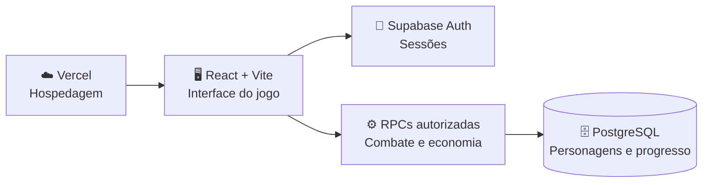

<div align="center">

# 🥷 KUROKAGE
### RPG ninja para navegador · GAME_NT

**Crie seu shinobi. Desenvolva suas técnicas. Evolua sua própria jornada.**

Um RPG web de progressão ninja com personagens, clãs, missões, combate e economia — construído com uma identidade visual própria e regras importantes validadas no servidor.

[](https://react.dev/)
[](https://www.typescriptlang.org/)
[](https://vite.dev/)
[](https://supabase.com/)
[](https://vercel.com/)

[**🎮 Abrir o jogo**](https://game-nt-larrats-projects.vercel.app) · [**🚀 Começar a desenvolver**](docs/GUIA-RAPIDO.md) · [**📚 Documentação**](docs/README.md) · [**🗺️ Próximas entregas**](docs/STATUS-DO-PROJETO.md)

</div>

---

> [!IMPORTANT]
> **Projeto em desenvolvimento ativo.** Ter uma tela implementada ou um deploy publicado não significa que o fluxo inteiro foi homologado. Raids verificadas e reset VIP permanecem desabilitados por configuração do servidor até o teste completo em staging.

## ✨ O jogo em poucas palavras

| 🧑‍🎓 Crie seu ninja | ⚔️ Entre em combate | 🌍 Evolua sua história |
| :--- | :--- | :--- |
| Escolha personagem, vila e classe. Todas as quatro classes começam com **10 pontos distribuídos entre os mesmos 10 atributos**. | Desenvolva sua build com jutsus, treinamento e encontros PvE com resultado controlado pelo servidor. | Explore missões, clãs, graduação, equipamentos, economia e outras atividades do mundo ninja. |

### Funcionalidades e estágio

| Sistema | O que existe no projeto | Situação |
| :--- | :--- | :--- |
| **Conta e personagem** | Autenticação, criação e seleção de até três personagens | ✅ Implementado · 🧪 E2E pendente |
| **Progressão** | 10 atributos, treinamento, clãs, elementos, graduações e jutsus | ✅ Implementado · 🧪 QA contínuo |
| **Aventura e combate** | Dojo, missões, PvE, história e adversários vinculados ao catálogo | ✅ Implementado · 🧪 QA contínuo |
| **Inventário e serviços** | Consumíveis, mochila com busca, equipamentos, Hospital, Ferreiro e Ichiraku | ✅ Implementado · 🧪 QA visual/funcional |
| **Raids e reset VIP** | Funções transacionais e testes SQL sintéticos | 🔒 **Desabilitados** até homologação |
| **Conteúdo e artes** | Catálogos, validador e pipeline de retratos aprovados | 🛠️ Expansão e revisão de imagens |
| **PvP ao vivo e exploração 2D** | Pesquisa e possibilidades futuras | 🧭 Planejado, não publicado |

<details>
<summary><strong>📊 Ver o tamanho do catálogo auditado</strong></summary>

Em **03/11/2026**, uma verificação somente leitura no Supabase encontrou:

- **188** personagens canônicos e **222** registros de avatares;
- **57** jutsus cadastrados;
- **15** NPCs ativos, todos associados a personagens válidos no catálogo;
- **184** URLs externas de retratos-base, ainda em processo de revisão e substituição por arquivos locais correspondentes.

Esses números são uma fotografia do banco naquela data, não uma promessa de conteúdo totalmente homologado.

[Detalhes da auditoria](docs/audits/CATALOG-CROSSCHECK-2026-11-03.md)

</details>

## 🧱 Como o projeto funciona



O cliente apresenta a experiência. **Operações críticas de progresso, inventário, custos, combate e recompensas dependem de validação no servidor**, com autenticação e regras de acesso por personagem.

## 🚀 Rodando em poucos passos

Você precisa do **Node.js 22+**, do npm e de um projeto Supabase configurado com o esquema necessário.

```bash
git clone https://github.com/larrat/game_nt.git
cd game_nt
npm ci
cp .env.example .env
```

Edite o arquivo `.env` usando **somente a URL e a chave publicável/anon** do seu projeto Supabase:

```dotenv
VITE_SUPABASE_URL=https://SEU-PROJETO.supabase.co
VITE_SUPABASE_ANON_KEY=SUA_CHAVE_PUBLICAVEL
```

Depois, execute:

```bash
npm run dev
```

Abra **http://localhost:5173** no navegador.

> [!CAUTION]
> Nunca coloque `service_role`, chave secreta, senha do PostgreSQL ou credenciais de usuários em variáveis `VITE_...`. Elas são incluídas no código entregue ao navegador. A instalação local **não** cria automaticamente tabelas, funções ou usuários no Supabase.

Para configurar autenticação, banco e deploy sem adivinhações, siga o [**Guia rápido de instalação e operação**](docs/GUIA-RAPIDO.md).

## ✅ Testes e ferramentas

| Comando | Utilidade |
| :--- | :--- |
| `npm test` | Testes automatizados do projeto |
| `npm run lint` | Análise estática |
| `npm run typecheck` | Verificação de tipos |
| `npm run build` | Build de produção |
| `node scripts/validate-reference-catalog.mjs` | Auditoria das referências de personagens |
| `node scripts/run-class-balance.mjs --samples=500 --level=10` | Simulação **offline e não autoritativa** das quatro classes |
| `node scripts/prepare-character-art.mjs` | Verificação prévia do manifesto de artes aprovadas, **sem publicar imagens** |

A suíte de duas contas (`npm run qa:staging`) só pode ser executada em **Supabase staging isolado**, com contas descartáveis e autorização explícita. Veja os [critérios de QA](docs/qa/JORNADA-CRITICA-2026-10-31.md).

## 📂 Onde encontrar cada coisa

| Pasta / arquivo | Conteúdo |
| :--- | :--- |
| [`src/`](src/) | Páginas, componentes, estilos, lógica de apresentação e utilitários |
| [`migrations/`](migrations/) | Evolução do esquema e funções PostgreSQL |
| [`tests/`](tests/) | Testes de comportamento e contratos |
| [`scripts/`](scripts/) | Auditorias, ferramentas e rotinas auxiliares |
| [`docs/`](docs/) | Especificações, UX, segurança, decisões e histórico |
| [`docs/STATUS-DO-PROJETO.md`](docs/STATUS-DO-PROJETO.md) | Estado, pendências e links para entregas recentes |

**Documentação aprofundada:** [arquitetura e visão](docs/KUROKAGE-DOCUMENTACAO-MESTRA-2026-11-01.md) · [Design System v4](docs/design/KUROKAGE-DESIGN-SYSTEM-V4.md) · [auditoria de segurança](docs/security/security-audit-2026-10-30.md).

## 🔒 Segurança, autoria e escopo

- O projeto é **independente**, inspirado no gênero de RPG ninja de navegador. Referências a outros jogos não indicam vínculo com seus responsáveis.
- Arte de terceiros e arquivos de engenharia reversa são **referências de estudo**, não permissões automáticas de publicação ou redistribuição. A importação exige identificação e revisão de direitos.
- O repositório é público, mas **não há arquivo de licença de software declarado na raiz**. Não presuma licença de reutilização de código ou assets.
- Mudanças que afetem economia, personagens reais, autenticação ou banco de produção exigem revisão, testes e plano de reversão.

<div align="center">

**KUROKAGE — a jornada continua.**

[⬆ Voltar ao início](#-kurokage) · [Acompanhar alterações](https://github.com/larrat/game_nt/pulls) · [Registrar um problema](https://github.com/larrat/game_nt/issues)

</div>
