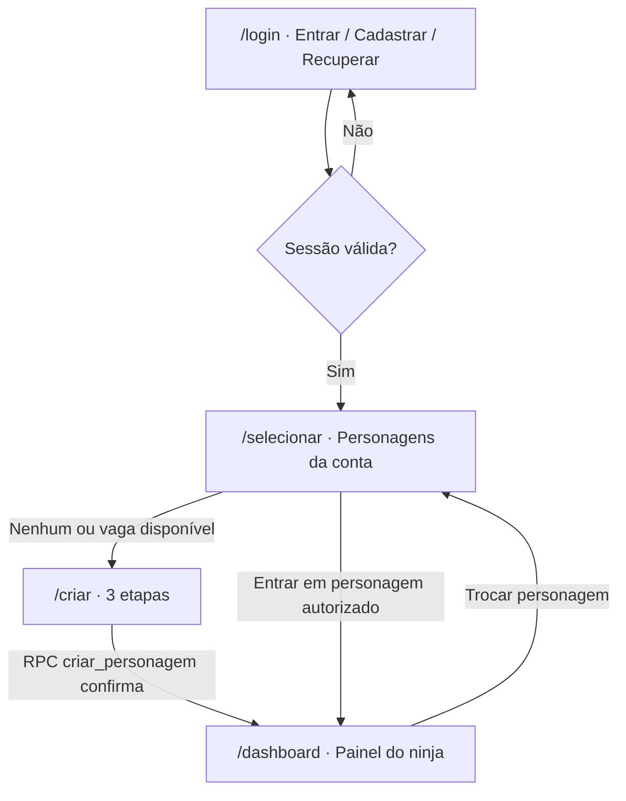

# Kurokage — Escopo UX do primeiro acesso (03/11/2026)

**Áreas:** login/cadastro/recuperação → seleção/criação de personagem → dashboard.  
**Propósito:** especificação executável para redesenho incremental, com dependência explícita da biblioteca local de retratos.  
**Estado:** escopo aprovado para revisão técnica, **não implementação, migração SQL ou homologação**.  
**Fontes:** `src/pages/{Login,RedefinirSenha,Selecionar,Criar,Dashboard}.jsx`; `src/App.jsx`; Design System v4; auditorias do catálogo e artes de 03/11; manual oficial Naruto Game de 2014 (referência histórica, não layout 2026 autenticado).

## 1. Jornada e regras de navegação



A aplicação usa estados de autenticação e personagem em `App.jsx`, portanto `/selecionar` e `/criar` só aparecem em sessão autenticada sem personagem ativo. Ao selecionar ou criar, a mudança de `playerState` abre o shell autenticado; não implementar navegação concorrente sem avaliar esse estado. O jogador desmaiado segue protegido pelo fluxo próprio do Hospital.

## 2. Diagnóstico do código existente

| Tela/área | Já existe | Lacuna concreta |
| --- | --- | --- |
| Login/recuperação | Modos de login, cadastro, esquecimento, reenvio; rota dedicada a redefinição e proteção de callback recovery | Revisão visual leve; ainda é necessário **teste real** de SMTP, confirmação, reset, expiração e URLs permitidas |
| Seleção (`Selecionar.jsx`) | Busca de `players` por `user_id`, 0 personagens, carrossel individual com Motion, nome/rank/vila/level, Ryous e barras Vida/Chakra/Stamina; RPC `excluir_personagem` | Melhor apresentar 1–3 slots simultaneamente e painel de foco; exclusão via `window.prompt` não segue design; reforçar estado vazio, foco, feedback e responsividade |
| Criação (`Criar.jsx`) | 3 etapas, pesquisa e paginação, lista inicial via `avatars.is_base`, prévia, vila, 4 classes, 10 atributos e 10 pontos de orçamento total, nome, revisão, `criar_personagem` | Muitos elementos competem por atenção e alguns retratos dependem de terceiros; simplificar composição, seleção/preview, legendas de variante e continuidade entre etapas |
| Dashboard (`Dashboard.jsx`) | Hero com retrato, rank, vila/clã, XP, HP/Chakra/Stamina; KPIs, atalhos, eventos, tarefas e bônus diários | Muitos painéis para primeira leitura; falta visão compacta dos 10 atributos e próximo objetivo prioritário; textos de recompensas `RY$ 20` e `RY$ 50` estão fixos no JSX, e devem ser confrontados com a regra do servidor antes de serem apresentados como valor garantido |
| Retratos | 188 personagens, 222 `avatars`; 31 IDs de avatar locais e 191 URLs externas no snapshot SQL; 28 arquivos do Sasuke na pasta de avatares | Cobertura não uniforme: Kakashi tem 1 avatar local, Madara tem 1 remoto; 184/188 `characters.base_avatar_url` externos |

**Limite da evidência visual:** a comparação arquivada em `docs/design/naruto-game-comparative-ux-audit-2026-10-30.md` é parcial. O site público atual não expõe uma sessão de jogo autenticada. O manual oficial de 2014 confirma a hierarquia retrato → identificação → recursos → ações, mas não pode ser tratado como captura atual do Round 53. Não copiar CSS, marca ou artes do Naruto Game.

## 3. Direção visual única

Manter o Design System v4 como fonte de verdade: fundo `#080d14`, painéis `#131c27`, dourado `#ebc17c`, vermelho `#d64750`, texto `#f3ecdf`; fontes e espaçamentos canônicos, ícones do registro `SidebarIcon`, botões `GameAction`, painéis `GamePanel` e `ResourceMeter`. Não criar outra paleta isolada para cada página.

**Tom visual:** refinado, ninja, noturno e legível; retrato é o foco emocional; informação é dividida por significado, não por decoração. Motion curto somente em seleção/troca/entrada, respeitando `prefers-reduced-motion`. Elementos de leitura têm prioridade sobre ornamentos.

## 4. Tela 1 — Acesso à conta (estabilização, sem reinvenção)

- Preservar layout/rotas existentes `/login` e `/redefinir-senha`, com comunicação coerente da marca Kurokage.
- Estados: entrar, cadastrar, e-mail pendente, reenviar, esqueci senha, senha nova, link inválido/expirado, carregando e falha.
- Após sessão confirmada, ir a `/selecionar`; uma sessão de recuperação de senha não pode antecipar a entrada no jogo.
- Testar em browser real; resposta de API não é prova de e-mail entregue.
- **Aceite:** AUTH-01, AUTH-02 e AUTH-03 em staging, sem regressões desktop/mobile.

## 5. Tela 2A — Selecionar personagem (`/selecionar`)

**Objetivo:** em poucos segundos o jogador reconhece suas fichas, compara e entra, sem navegação confusa.

### Composição proposta

```text
┌────────────────────────────────────────────────────────────────┐
│ KUROKAGE                                  CONTA / SAIR         │
│ Escolha seu shinobi                      1–3 vagas ocupadas    │
├────────────────────────────────────────────────────────────────┤
│ [Personagem 1]  [Personagem 2]  [+ Criar personagem]             │
│  retrato        retrato           quando vaga disponível      │
├────────────────────────────────────────────────────────────────┤
│ RETRATO MAIOR       NOME · CLASSE · VILA · GRADUAÇÃO            │
│                     Nível/XP · Ryous · VIDA/CHAKRA/STAMINA      │
│                     [ ENTRAR NO JOGO ]                         │
│                     [ Detalhes ] · [ Excluir com segurança ]  │
└────────────────────────────────────────────────────────────────┘
```

- 0 personagens: estado vazio com ilustração da marca e CTA `Criar meu primeiro ninja`.
- 1 personagem: centralizar retrato e mostrar duas vagas vazias opcionais, sem setas inúteis.
- 2 ou 3 personagens: slots visíveis no desktop; lista rolável com seleção explícita no mobile, sem ocultar o CTA principal.
- Escolha deve mostrar a mesma imagem e o mesmo personagem em seleção, dashboard e status; se asset indisponível, fallback visual consistente e registro diagnóstico.
- Exibir apenas dados da ficha realmente retornados pelo servidor; não revelar campos privados de outras contas.
- Excluir: substituir `window.prompt` por diálogo acessível com nome digitado, consequências, cancelamento evidente, botão de perigo e chamada à mesma RPC `excluir_personagem`. Sem alteração da autoridade no servidor.
- Erro, carregando, desconexão, reentrada, duplo clique, sucesso e reduzido movimento são estados obrigatórios.

**Aceite:** 0/1/2/3 fichas, 4ª bloqueada no servidor, exclusão sem efeitos no cancelamento, bloqueio de conta B, teclado, 320/390/768/1440px.

## 6. Tela 2B — Criar personagem (`/criar`)

**Objetivo:** seleção de imagem compreensível e personagem criado corretamente na primeira tentativa, mantendo a regra de 3 etapas.

| Etapa | Composição | Regras |
| --- | --- | --- |
| **1. Personagem e visual** | Busca + filtros futuros por origem/série, cards uniformes, destaque grande do selecionado, faixa de aparências *iniciais* aprovadas | Um ID canônico de personagem por card; foto não muda classe nem dá bônus; usar apenas `avatars.is_base=true` na criação, validado também na RPC |
| **2. Vila e classe** | Cards de vila e 4 especializações; comparação clara das 10 estatísticas iniciais, descrição breve de vantagens | **10 pontos em todas as classes, distribuídos nos mesmos 10 atributos**; não dar pontos extras por escolha estética |
| **3. Nome e confirmação** | Recapitulação visual com retrato, nome, vila, classe, atributo inicial, saldo real conferido e CTA único | Validar nome/disponibilidade; um clique/uma RPC `criar_personagem`; erro preserva escolhas; retorno confirmado ativa personagem |

- Prever indicação de carregamento em imagens; impedir cards com imagens cortadas, de baixa dimensão ou de personagem errado.
- Informar claramente quantas das 3 vagas foram usadas.
- Evitar mostrar variantes inacessíveis como clicáveis; se vistas como prévias, sinalizar desbloqueio, requisitos e não enviar à RPC de criação.
- Não mudar IDs de personagens, classes, limites, custos, bônus ou regras do servidor para implementar o novo layout.
- **Aceite:** 188 personagens com fallback coerente; catálogo paginado e pesquisável; 4 perfis com 10 pontos; criação e tentativa concorrente de 4º personagem; persistência após refresh.

## 7. Tela 3 — Dashboard (`/dashboard`)

**Objetivo:** na primeira dobra, responder `Quem sou?`, `Como está meu ninja?` e `O que devo fazer agora?`.

```text
┌─────────────────────────────────────────────────────────────────┐
│ NOME · RETRATO GRANDE     VILA / CLÃ / CLASSE / GRADUAÇÃO      │
│ NÍVEL + XP                HP / CHAKRA / STAMINA                │
├─────────────────────────────────────────────────────────────────┤
│ ATRIBUTOS ESSENCIAIS (10)    │ PRÓXIMO PASSO RECOMENDADO      │
│ resumo + link "Ver Status"   │ missão/treino/objetivo real    │
├─────────────────────────────────────────────────────────────────┤
│ RYOUS · PONTOS LIVRES · CONQUISTAS/MISSÕES · COMBATES            │
│ [Treinar] [Missões] [Técnicas] [Equipamentos] [Dojo]           │
├─────────────────────────────────────────────────────────────────┤
│ EVENTOS REAIS · ROTINA DIÁRIA · RECOMPENSAS (se confirmadas)    │
└─────────────────────────────────────────────────────────────────┘
```

- Hero do jogador e recursos acima da dobra; informações compactas, não uma parede de widgets.
- Mostrar os dez atributos básicos em bloco escaneável com link para `/status`; atributos derivados e fórmulas completas pertencem prioritariamente a Status.
- Unificar interpretação de nível/XP entre seleção, dashboard e Status. Não inferir valores incompatíveis de `player.level` e XP.
- Próximo passo contextual deve vir de estado legítimo de missão/treino. Se não houver dado, exibir chamada neutra para começar, sem afirmar tarefas concluídas.
- Movimentações de economia (bônus, baú, Ryous) mantêm RPCs existentes; **valores em cards devem ser obtidos de fonte autoritativa ou omitidos**, nunca presumidos por JSX.
- Eventos só se ativos/agendados conforme banco, com vazio honesto.
- Fichas sem clã, XP=0, recursos zerados, retrato em fallback e perfil recém-criado devem renderizar corretamente.
- **Aceite:** mudança de personagem atualiza imediatamente hero, atributos, recursos e ganhos sem cache cruzado; nenhuma recompensa duplicada; responsividade e contraste.

## 8. Biblioteca local de imagens — caminho obrigatório antes do redesign final

### 8.1 Fotografia atual

- SQL, 03/11: **188** `characters`; **222** `avatars`; **31** `avatars.id` locais e **191** IDs remotos; **184** URLs externas em `characters.base_avatar_url`.
- Repositório: `public/images/avatares/` contém 28 imagens do Sasuke; `public/images/` contém Naruto, Sakura, Kakashi e outros assets; `public/images/characters/` contém três retratos de correspondência comprovada (Hinata, Hiruzen e Juzo).
- Acervo de estudo: `docs/reverse-engineering/coleta-2026-10-30/personagens-catalogo/imagens/`, **711 arquivos**; apenas 3 correspondências exatas comprovadas com o catálogo inicial na auditoria. Não representam cobertura local já pronta.
- O manifesto de publicação `data/approved-character-art.json` começa vazio. `scripts/prepare-character-art.mjs` suporta geração local controlada, sem associação automática no banco.

### 8.2 Modelo de associação e integridade

**Não trocar `avatars.id` cegamente:** atualmente o ID é frequentemente a própria URL/caminho, e `players.avatar` e `avatars.evolution_target_id` podem referenciá-lo. Renomear esse ID pode invalidar fichas existentes, seleções, evoluções ou chaves estrangeiras.

Abordagem proposta, condicionada a inspeção de constraints, triggers e RPCs:
1. Inventariar **cada aparição usada no jogo** (`character_id`, ID de avatar, visual, categoria, se pode ser inicial, origem, resolução, hash, situação de direitos, existência física, impacto das referências).
2. Definir um **campo de exibição local** `asset_path`/catálogo de assets, separado do identificador estável do avatar; preferir mudança aditiva/reversível. Não supor que `avatars.id` aceita novos valores sem migração.
3. Processar somente fontes autorizadas e identificadas; gerar thumb e retrato principal com dimensões apropriadas, sem ampliar artificialmente imagens pequenas. Armazenar em `public/images/characters/{personagem}/{versao}/{asset}.webp` ou storage próprio controlado, sem serviço pago obrigatório.
4. Registrar a relação de *ID estável → arquivo local aprovado*; UI usa local primeiro, fallback apropriado e sem hotlink permanente quando o lote estiver 100% coberto.
5. Migrar leitura das telas por etapas; revisar `characters.base_avatar_url`, `avatars`, `players.avatar`, `AvatarModal`, `CharacterPortrait`, seleção, criação, TopBar, Dashboard e Status. **Não reescrever o avatar salvo do jogador sem garantir compatibilidade.**
6. Fazer SQL em **staging**, transacional, com verificação de integridade, RLS, RPC e rollback. Produção somente após prova de dados e imagens; registrar métricas de falha de carregamento.

**Meta de conclusão da biblioteca:** 100% das aparências *ativas/aprovadas* usadas pelas telas carregam de caminho local próprio; zero imagens de personagem quebradas; associação exata; nenhuma troca silenciosa de personagem/variante; nenhum usuário antigo perde seu retrato.

**Importante:** a meta não autoriza copiar ou publicar imagens de terceiros sem documentação da autorização aplicável. O acervo de estudo e arquivos externos não são assets aprovados por padrão.

## 9. Backlog de execução em PRs pequenas

| Ordem | Entrega | Arquivos principais | Gate de conclusão |
| --- | --- | --- | --- |
| 0 | Congelar contrato visual de acesso e testar fluxo de login/recovery | `Login.jsx`, `RedefinirSenha.jsx`, QA | E-mails e callback validados em staging |
| 1 | Auditoria executável e manifesto da biblioteca de personagens | `public/images`, `data/reference`, ferramenta read-only, testes | Inventário sem lacunas não classificadas, direitos e caminhos revisados |
| 2 | Resolver retratos locais sem quebrar IDs do banco | `CharacterPortrait`, catálogo de assets, migrations **aditivas**, testes | Personagem/variante corretos em 0/1/3 fichas e perfis antigos |
| 3 | Seleção 3.0 com slots e exclusão acessível | `Selecionar.jsx`, CSS e componentes compartilhados | QA desktop/mobile + autorização A/B |
| 4 | Criação 6.0 no mesmo fluxo de três etapas | `Criar.jsx`, CSS, helpers, testes e RPC existente | 10 pontos/10 atributos, 3 personagens, avatar inicial elegível |
| 5 | Dashboard 3.0 e correção de fontes de dados | `Dashboard.jsx`, `Status.jsx` (somente integração), presentation, testes | Dados reais coerentes e nenhum valor fixo de prêmio enganoso |
| 6 | Homologação completa e rollout | QA staging, CI, preview, deploy | 320/390/768/1440, duas contas, imagens 100% ativas locais |

**Sequência de aplicação:** não aguardar necessariamente a substituição de todo o acervo para construir layout em preview; usar placeholders locais e flags de prontidão. **Não declarar pronto/publicar como pacote final** antes de cobertura visual aprovada, integridade SQL e jornada E2E.

## 10. Estados e critérios de aceite transversais

- **Desktop/tablet/mobile** em 1440, 768, 390 e 320px; nenhuma barra horizontal involuntária ou modal fora da viewport.
- Todos os controles por teclado/touch; foco evidente, labels, alt, `aria-live` apropriado, loading, erro, vazio, redução de movimento.
- Imagens com dimensões/aspect ratio consistentes, sem alteração de rosto/variante; loading lazy para grid e eager para hero.
- Controles de economia e identidade mantidos em RPCs; não inserir chaves de serviço no cliente.
- Conta A não lê, edita ou exclui ficha de B; exclusão e criação possuem verificação de propriedade server-side.
- Validar 0/1/2/3 personagens, 4ª tentativa, sessão expirada, duplo clique, refresh, entrada em personagem sem imagem, criação após retorno de erro.
- `npm test`, `npm run lint`, `npm run typecheck`, `npm run build`; E2E separado com credenciais descartáveis e screenshot autorizado.
- Capturas autenticadas **do nosso Kurokage** devem ser coletadas no preview antes de homologar. Referências históricas do Naruto Game não substituem essa prova.

## 11. Referências

- [Design System v4](KUROKAGE-DESIGN-SYSTEM-V4.md)
- [Comparativo histórico Naruto Game × Kurokage](naruto-game-comparative-ux-audit-2026-10-30.md)
- [Auditoria de cobertura local](../audits/local-character-portrait-coverage-2026-11-03.md)
- [Pipeline de artes autorizadas](../audits/APPROVED-CHARACTER-ART-PIPELINE-2026-11-03.md)
- [Jornada de QA](../qa/JORNADA-CRITICA-2026-10-31.md)
- Manual oficial de 2014: https://www.narutogame.com.br/Manual_Basico_Naruto_Game_R10_v1.pdf
- Site público do Naruto Game: https://narutogame.com.br/
